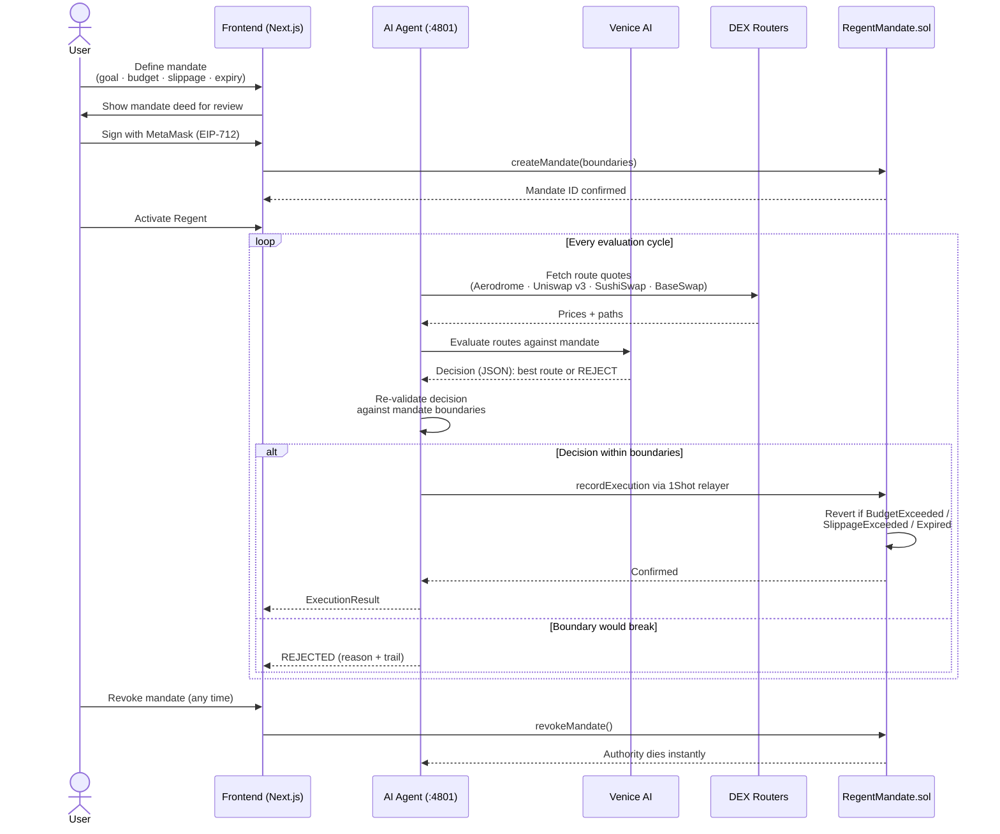
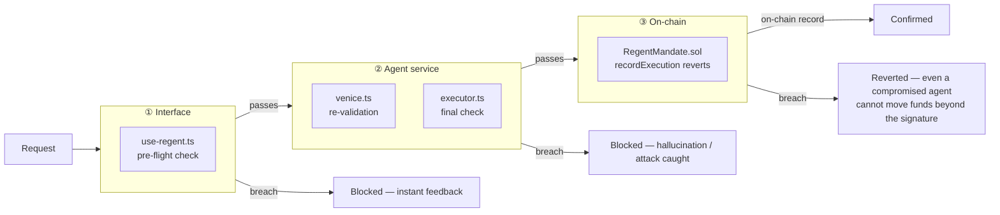
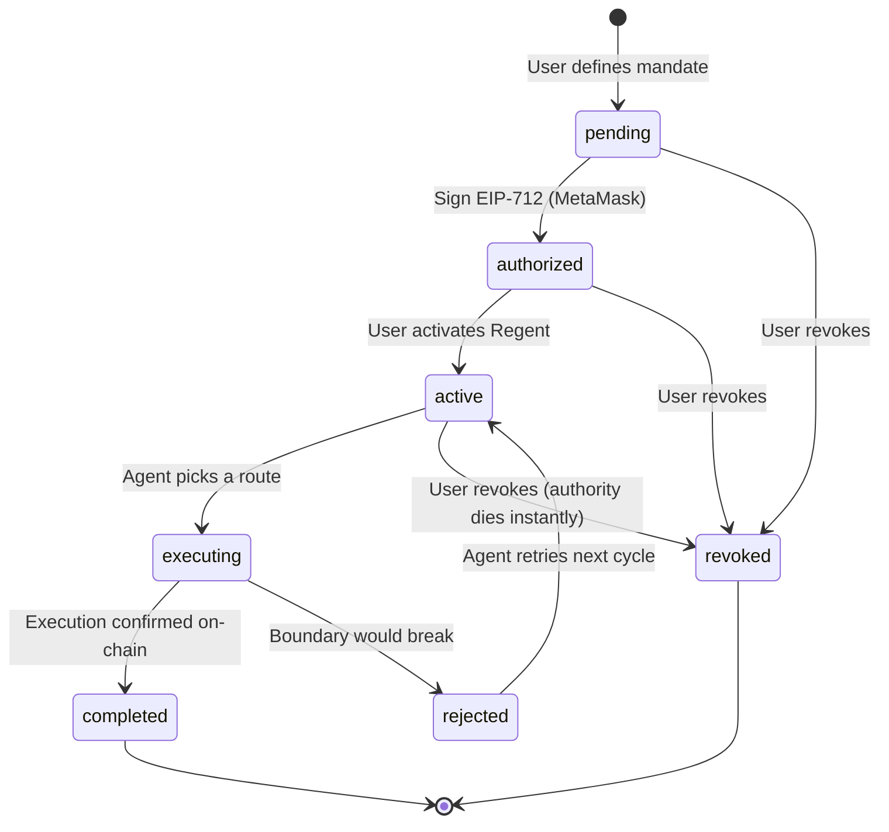

# Regent

> You give the mandate. Regent executes.

---

## The problem

DeFi is powerful but requires you to babysit it.

You spot an opportunity — swap ETH for USDC before slippage spikes, execute a DCA entry at the right price, rebalance before a deadline. But you're asleep. Or at work. Or you just don't want to watch a screen for six hours waiting for the right moment.

So you either miss it, or you hand your private key to an automation script and hope for the best. Both options are bad.

**Regent solves this without custody.**

You sign a bounded mandate — spend at most $500, accept no more than 1% slippage, expire in 24 hours — and an AI agent executes *within those exact limits*. The boundaries are enforced three independent times: in the interface, in the agent, and on-chain. No key ever leaves your wallet.

---

## How it works



---

## Trust model — why three layers

A single guard is a single point of failure. Regent enforces every boundary three independent times:



A bug or compromise in any one layer cannot move funds beyond the mandate.

---

## Mandate lifecycle



Every transition is appended to the audit log with a timestamp and source tag (`venice` / `heuristic` / `simulated`, `relayer` / `simulated`) — the trail is part of the product.

---

## Quick start

```bash
npm install

# terminal 1 — AI agent service (:4801)
npm run agent

# terminal 2 — web app (:3000)
npm run dev
```

Open [http://localhost:3000](http://localhost:3000). **No keys or testnet funds needed** — every layer falls back to simulation and labels it honestly in the UI.

The full flow: give a mandate → review the deed → authorize → activate Regent → watch it scan routes, reason, and execute within your limits — or refuse when a boundary would break.

---

## Structure

```
frontend/    Next.js 16 app — landing, dashboard, mandate flow, /api/agent proxy
ai-agent/    Agent service — Venice AI evaluation + 1Shot execution (Node 24, zero deps)
contract/    Foundry — RegentMandate.sol: on-chain budget/slippage/expiry guard (11 tests)
```

How they connect: [ARCHITECTURE.md](ARCHITECTURE.md). Roadmap: [TASKS.md](TASKS.md). Design system: [brand.md](brand.md).

---

## Going live

| Step | How |
|---|---|
| Venice AI decisions | `ai-agent/.env`: `VENICE_API_KEY=...` |
| Deploy the contract | `cd contract && PRIVATE_KEY=0x... ./script/deploy.sh` |
| On-chain mandates | `frontend/.env.local`: `NEXT_PUBLIC_MANDATE_CONTRACT=0x...` |
| 1Shot execution | `ai-agent/.env`: `EXECUTION_MODE=live`, `MANDATE_CONTRACT=0x...` |

```bash
npm run contract:test    # forge test — the mandate guard suite (11 tests)
npm run build            # production frontend build
```

---

## Hackathon tracks

- **Best Agent** — Regent *is* the agent: bounded delegation with an auditable decision trail
- **Best Use of Venice AI** — route evaluation and the decision engine (`ai-agent/src/venice.ts`)
- **Best Use of 1Shot Permissionless Relayer** — gas-abstracted delegated execution (`ai-agent/src/executor.ts`)

---

## Smart Accounts Kit — Dual ERC-7710 Delegations

Regent implements standard MetaMask ERC-7710 delegations split into two distinct, narrowly scoped delegations signed by the user's Smart Account:
1. **`approveDelegation`**: Approves USDC spending exclusively for Uniswap `SwapRouter02` (`0x94cC0AaC535CCDB3C01d6787D6413C739ae12bc4`).
2. **`swapDelegation`**: Executes `exactInputSingle` on SwapRouter02 with calldata offsets locked to tokenIn = USDC, tokenOut = WETH, and recipient = the user's Smart Account, with `ERC20BalanceChangeEnforcer` ensuring spend does not breach budget.

Both delegations are created with unique salts so they can be independently validated and revoked.

### Creating Delegations

| What | File |
|---|---|
| Dual ERC-7710 delegation construction with caveat enforcers | [`frontend/src/lib/delegation.ts` → `buildMandateDelegations`](frontend/src/lib/delegation.ts) |
| Delegation signing via MetaMask Smart Account (`signDelegations`) | [`frontend/src/lib/delegation.ts` → `signMandateDelegations`](frontend/src/lib/delegation.ts) |
| Delegation orchestration — connects wallet, signs dual delegations, registers on-chain | [`frontend/src/hooks/use-regent.ts` → `authorize`](frontend/src/hooks/use-regent.ts) |
| On-chain mandate registration — `createMandate(agent, budget, slippage, expiry)` via viem | [`frontend/src/lib/contract.ts` → `registerMandateOnChain`](frontend/src/lib/contract.ts) |
| `RegentMandate.createMandate` — on-chain registry entry and boundary configuration | [`contract/src/RegentMandate.sol` → `createMandate`](contract/src/RegentMandate.sol) |

### Redeeming Delegations

| What | File |
|---|---|
| Agent bundles both delegations in `SingleDefault` mode into `redeemDelegations` | [`ai-agent/src/executor.ts` → `buildExecutionCalldata`](ai-agent/src/executor.ts) |
| `RegentMandate.recordExecution` — runs first, enforcing all clauses and reverting on breach | [`contract/src/RegentMandate.sol` → `recordExecution`](contract/src/RegentMandate.sol) |
| Direct EOA execution or 1Shot relayer submission (`relayer_send7710Transaction`) | [`ai-agent/src/executor.ts` → `executeRoute`](ai-agent/src/executor.ts) |

### Revoking Authority

The owner can revoke at any time. Revocation performs two on-chain actions:
1. Disables both delegations in MetaMask `DelegationManager` via a bundled Smart Account UserOp.
2. Calls `revokeMandate` on `RegentMandate.sol`, permanently revoking authority on-chain.

- UI revoke: [`frontend/src/hooks/use-regent.ts` → `revoke`](frontend/src/hooks/use-regent.ts)
- Contract enforcement: [`contract/src/RegentMandate.sol` → `revokeMandate`](contract/src/RegentMandate.sol)
- Delegation disabling UserOp: [`frontend/src/lib/contract.ts` → `disableDelegationOnChain`](frontend/src/lib/contract.ts)

---

## Base Sepolia Runbook

For a comprehensive guide on deploying the contracts, configuring live credentials, and testing the live delegation flow on Base Sepolia, see **[docs/RUNBOOK_BASE_SEPOLIA.md](docs/RUNBOOK_BASE_SEPOLIA.md)**.

---

## 1Shot API Usage

The 1Shot permissionless relayer handles gas abstraction: the agent posts an ERC-7710 delegation bundle via `relayer_send7710Transaction` without the user needing native gas tokens.

| What | File |
|---|---|
| `relayer_send7710Transaction` call — submits the swap + `recordExecution` bundle | [`ai-agent/src/executor.ts`](ai-agent/src/executor.ts#L27) |
| Boundary pre-check before relayer submission (budget, slippage, expiry) | [`ai-agent/src/executor.ts` → L14–23](ai-agent/src/executor.ts#L14) |
| Relayer URL + live-mode config | [`ai-agent/src/config.ts`](ai-agent/src/config.ts) |
| Frontend proxy that triggers execution | [`frontend/app/api/agent/execute/route.ts`](frontend/app/api/agent/execute/route.ts) |

Execution falls back to a clearly-labeled simulation when `EXECUTION_MODE` is not `live`, so the full product flow works with zero configuration.

---

## Venice AI Usage

Venice AI is the decision engine: it receives live DEX route quotes and the active mandate, then returns a strict JSON verdict — which route to pick, or `null` to reject. The mandate re-validates every verdict so a hallucinated pick can never authorize a spend.

| What | File |
|---|---|
| Venice `chat/completions` call with `response_format: json_object` | [`ai-agent/src/venice.ts` → `evaluateRoutes`](ai-agent/src/venice.ts#L13) |
| Prompt construction — routes + mandate constraints serialized for the model | [`ai-agent/src/venice.ts` → `buildPrompt`](ai-agent/src/venice.ts#L62) |
| Post-decision re-validation — Venice verdict checked against hard boundaries | [`ai-agent/src/venice.ts` → L44–47](ai-agent/src/venice.ts#L44) |
| Heuristic fallback (same policy, deterministic) used when no API key is set | [`ai-agent/src/venice.ts` → `heuristicDecision`](ai-agent/src/venice.ts#L84) |
| Venice config — `VENICE_API_KEY`, `VENICE_MODEL`, `VENICE_API_URL` | [`ai-agent/src/config.ts`](ai-agent/src/config.ts) |

---

## Feedback

If you use Regent and run into rough edges, unexpected behavior, or ideas for improvement — please open an issue:

**[github.com/artomily/regent/issues](https://github.com/artomily/regent/issues)**

Areas particularly worth feedback on:
- The mandate creation UX — are the four clauses (goal, budget, slippage, expiry) clear enough?
- Demo mode transparency — is it obvious what's simulated vs real?
- The agent refusal messages — do they explain *why* a route was rejected clearly?
- Trust model explanations — does the three-layer enforcement story land?

---

## Social Media

Follow the build on X: **[@regentonchain](https://x.com/regentonchain)**

> You give the mandate. Regent executes. — an AI agent that acts inside hard, signed boundaries. No custody. No key exposure. Built on MetaMask Smart Accounts + Venice AI + 1Shot on Base Sepolia.

---

## Contributing

Contributions are welcome — see [CONTRIBUTING.md](CONTRIBUTING.md) for setup, conventions, and PR expectations. Please review [SECURITY.md](SECURITY.md) before reporting anything that looks like a mandate-boundary bypass.

## License

MIT — see [LICENSE](LICENSE).
